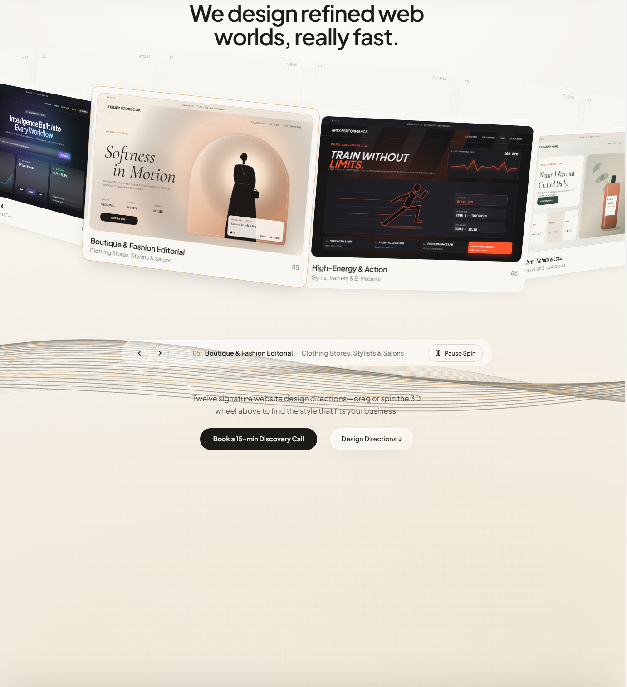
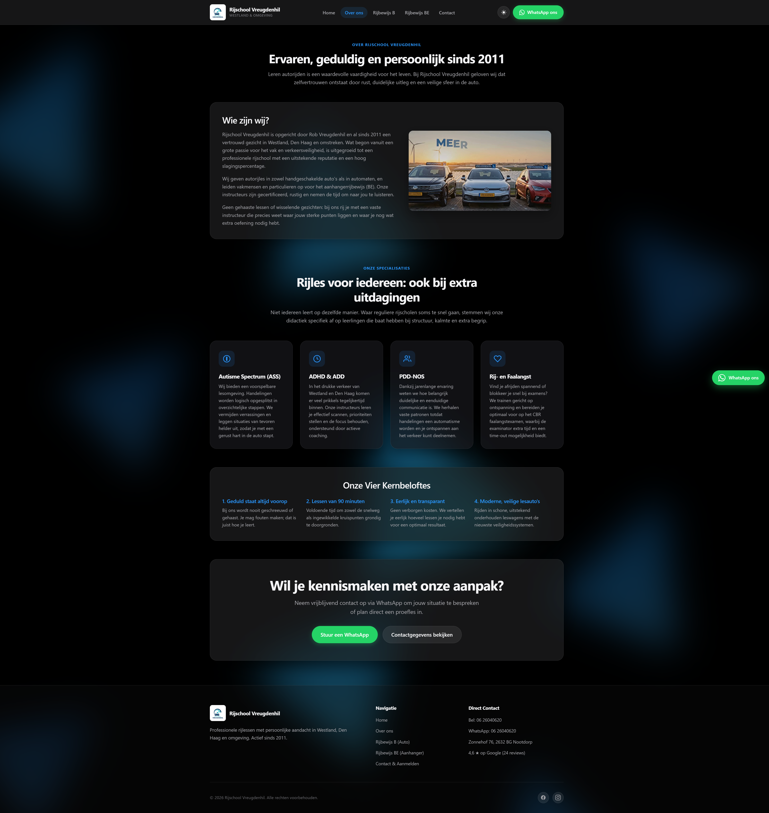
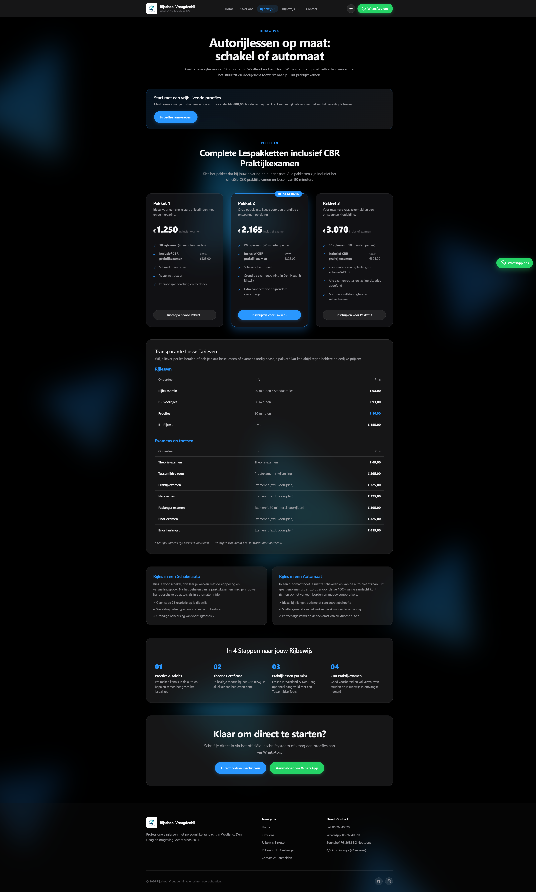
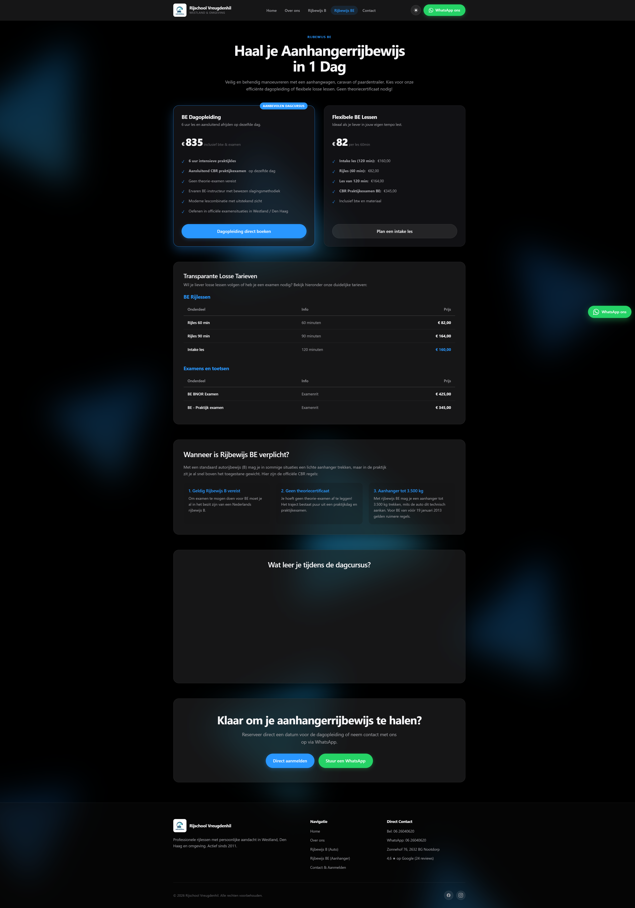
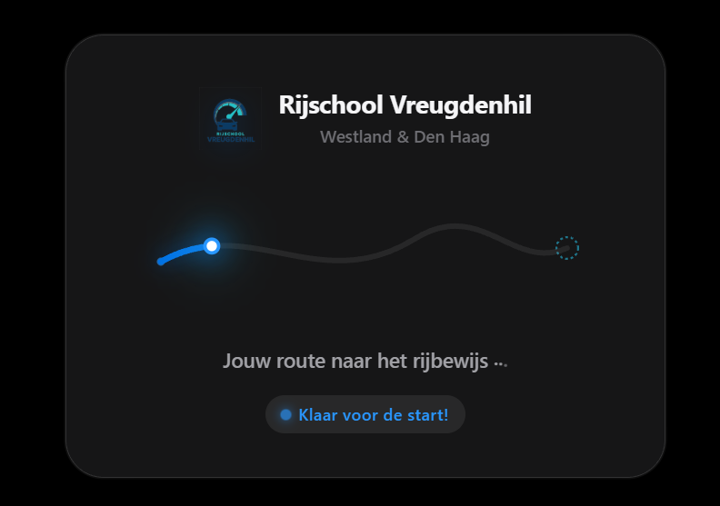
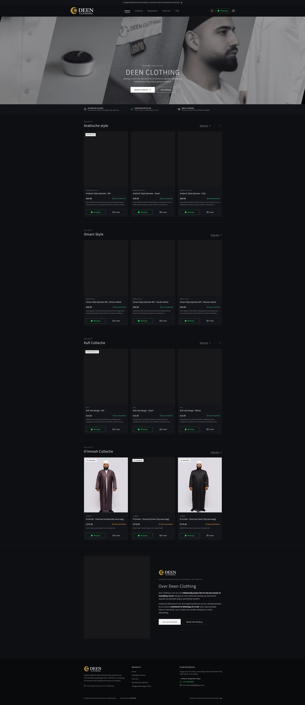
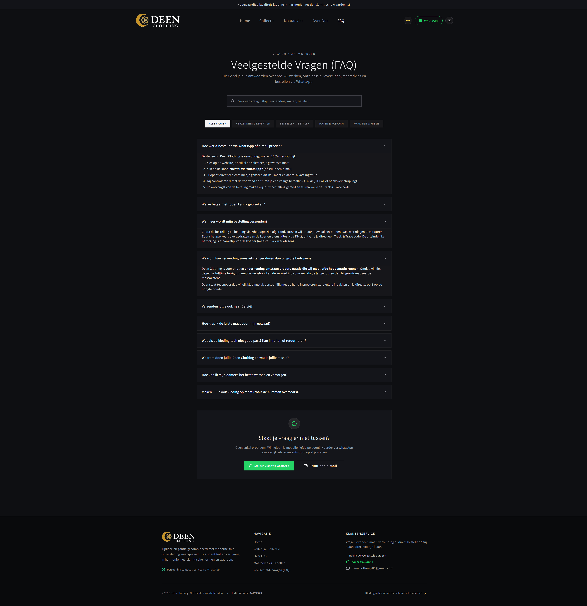

# FORMA — Beoordeling & Roadmap (Punt nr. 1 t/m nr. 13)

> **Status:** Alleen documentatie & beoordeling — **nog niets gebouwd in de applicatiecode**.  
> Alle aangeleverde screenshots uit onze chat zijn veilig opgeslagen in `public/assets/aistudio/` en worden hieronder direct gelinkt ter referentie.

---

## Overzicht van alle punten

| Nr. | Onderwerp | Status / Actie | Prioriteit |
| :--- | :--- | :--- | :--- |
| **nr. 1** | Witruimte onderaan Hero-sectie oplossen | Eerst ontwerpkeuze maken | Hoog |
| **nr. 2** | Sectie 4: Transparante Sprint-pakketten / Prijzen | **Nog even wachten** (model eerst bepalen) | Later |
| **nr. 3** | Echte klantcases & resultaten (3 echte websites) | Klaar voor structuur & echte metrics | Hoog |
| **nr. 4** | FAQ-sectie (bezwaren wegnemen) | **Nog even wachten** (na prijzen/flow) | Later |
| **nr. 5** | Live eigen merknaam typen in Style Playground | Zeer sterk — direct meenemen in volgende bouwfase | Hoog |
| **nr. 6** | Mobile vs. Desktop toggle in Playground-podium | Zeer sterk — direct meenemen in volgende bouwfase | Hoog |
| **nr. 7** | Directe "Share / Bewaar combo" URL-link | Zeer sterk — makkelijk te combineren met nr. 5 & 6 | Midden |
| **nr. 8** | Taalkeuze (voorlopig 100% Engels) | Akkoord — één bron bijhouden tot alles staat | Afgesproken |
| **nr. 9** | Werkende afhandeling van `SprintBookingDrawer` | Koppeling kiezen (WhatsApp + Webhook/Mail + Cal.com) | Hoog |
| **nr. 10a** | Footer met directe contactopties, WhatsApp & Legal | NL/EU-gegevens + directe acties toevoegen | Midden |
| **nr. 10b** | Klantcommunicatie, 3-uurs feedbackregel & WhatsApp-alerts | Operationele workflow kiezen & opzetten | Hoog |
| **nr. 11** | Sterkere marketing- en conversieteksten | Copy-richting per sectie beoordelen | Hoog |
| **nr. 12** | Interactieve fictieve Demo One-Pagers (RDW, Weer, etc.) | Uitgewerkt als one-pagers i.c.m. de 9 Playground-stijlen | Hoog |
| **nr. 13** | Strategische Beoordeling & Aanbevolen Bouwvolgorde | 3-sprint bouwplan als leidraad voor uitvoering | Overzicht |

---

## nr. 1 — Witruimte onderaan de Hero-sectie oplossen

### Diagnose (uit huidige code `src/components/HeroSection.tsx`)
- De Hero heeft momenteel `md:pb-[30svh]` (30% van de schermhoogte aan lege ondermarge) zodat er scrollruimte is voordat Sectie 2 over de Hero heen schuift, plus `mt-10 md:mt-12` boven de subtekst.
- Gevolg op desktop (zoals zichtbaar in de screenshot): zodra je net iets scrolt, ontstaat er een groot leeg vlak onder de twee knoppen (`Book a 15-min Discovery Call` & `Design Directions ↓`).

### Drie opties om dit strak op te lossen
1. **Optie A — Compacter + Proof Strip onderin (Aanbevolen):**
   - Verklein de onderste padding van `md:pb-[30svh]` naar `md:pb-14` (de sticky-overgang blijft werken, alleen sneller en zonder leeg gat).
   - Vul de ruimte direct onder de knoppen met een subtiele **3-koloms Trust / Proof Strip** (`.glass-subtle`), bijv.:
     - `24–48h Sprint Delivery` · *From brief to live preview without agency lag*
     - `3+ Live Client Launches` · *Salons, driving schools & D2C commerce*
     - `Mobile-First & Fast` · *Sub-second load & direct WhatsApp conversion*
2. **Optie B — Alleen strak trekken zonder extra strip:**
   - Alleen `md:pb-[30svh]` terugbrengen naar `md:pb-12` en de Section 2 (`02 · Design Directions`) lip eerder laten aansluiten zodat de bezoeker direct de overgang ziet.
3. **Optie C — Scroll-cue + Live klantlogo's:**
   - Compacte rij *"Trusted by local & D2C businesses: New Look Uithoorn · Rijschool Vreugdenhil · Deen Clothing"* + subtiele scroll-indicator (`Scroll to explore ↓`).

> **Vraag aan jou:** Gaan we voor **Optie A** (strakkere padding + 3-punts Proof Strip), **Optie B** (puur inkorten), of **Optie C** (klantnamen + scroll-cue)?

---

## nr. 2 — Transparante Sprint-pakketten / Prijzen (Sectie 4 — *Nog even wachten*)

### Beoordeling
Goed dat je hier nog even mee wacht tot je exact weet hoe je je aanbod wilt positioneren. Twee routes die in Nederland voor dit type studio het best converteren:

1. **Model 1: Eenmalig Bouwen + Optioneel Maandelijks Care-pakket (Meest laagdrempelig qua administratie):**
   - **Sprint One-Pager** — *Vanaf €X eenmalig* (live binnen 24–48u, 1 sterke landingspagina, WhatsApp/contact-flow, basis SEO).
   - **Multi-Page Studio Website** — *Vanaf €Y eenmalig* (3–6 pagina's zoals Rijschool Vreugdenhil, maatwerk interacties, Google Reviews integratie). *(Label: `Most Popular`)*
   - **Commerce / Catalogus op maat** — *Vanaf €Z eenmalig* (zoals Deen Clothing met collecties, filters, maatadvies & WhatsApp-bestelflow).
   - *Optionele toggle/add-on:* **Monthly Care & Hosting (€X/mnd)** — snelle aanpassingen, hosting, SSL en uptime monitoring.
2. **Model 2: Maandelijks Abonnement (WaaS) vs. Eenmalig (Toggle zoals Monthly / Annual):**
   - Voor ondernemers die geen groot bedrag vooraf willen betalen (bijv. `€89/mnd` all-in vs. `€950 eenmalig`).
   - *Aandachtspunt:* Bij maandelijks model moet je zelf incasso/opzegtermijn regelen (Stripe/Mollie SEPA) en loop je risico als iemand na 2 maanden stopt, tenzij er een minimale looptijd (bijv. 12 mnd) of opstartfee is.

---

## nr. 3 — Echte Klantcases & Resultaten (3 Echte Projecten)

Je hebt 3 sterke, heel uiteenlopende praktijkcases aangeleverd. Dit is goud waard voor vertrouwen: bezoekers zien direct dat je niet alleen mooie concepten maakt, maar **echte Nederlandse ondernemers helpt met snelle, conversiegerichte websites**.

### Case 1: New Look Barbershop Uithoorn (`newlookuithoorn.nl`)

- **Wat we op de site zien:**
  - Donker luxe zwart/goud design met duidelijke diensten (*Vakmanschap, Knippen & Scheren, Service*), 3-koloms transparante prijslijst, 4-foto galerij, productlijn, fysieke stempelkaart-sectie, openingstijden en **4.9 / 5 Google Reviews (136 reviews)**.
  - Directe WhatsApp-actie voor afspraken zonder ingewikkeld boekingssysteem.
- **Sterke case-instek voor FORMA:**
  - *Sector:* Salons & Local
  - *Opgelost probleem:* Lokale klanten willen binnen 10 seconden prijzen, sfeer, openingstijden en bewijs (reviews) zien.
  - *Hard bewijs / metric voor op de kaart:* `4.9★ Google Rating (136 reviews)` · `3-Step Price & Gallery Structure` · `Direct WhatsApp Booking`.
  - *(Let op voor visual in case-card: in de full-page screenshot was het "Vind Ons" kaartblok wit/leeg door de screenshot-capture; we gebruiken daarom het bovenste hero/services/reviews gedeelte of een strakke crop.)*

---

### Case 2: Rijschool Vreugdenhil — Westland & Den Haag (`rijschoolvreugdenhil.nl`)
| Homepage | Over ons & Specialisaties | Rijbewijs B Pakketten |
| :---: | :---: | :---: |
|  |  |  |

| Rijbewijs BE (1 Dag) | Contact & WhatsApp | Custom Route Laadanimatie |
| :---: | :---: | :---: |
|  |  |  |

- **Wat we op de site zien:**
  - Compleet multi-page platform (Home, Over ons, Rijbewijs B, Rijbewijs BE, Contact) in donkerblauw/electric blue.
  - Sterke positionering op vertrouwen & specialisaties (ASS, ADHD, Faalangst), transparante lespakketten (`€1.250 / €2.165 Meest Gekozen / €3.070`), losse CBR-tarieven, 1-daagse aanhangeropleiding (`€835`), koppeling met officieel leerlingportaal (*Startmetjerijbewijs.nl*) én WhatsApp-formulier dat de chat kant-en-klaar opent.
  - **Signature detail:** De custom route-laadanimatie (*"Jouw route naar het rijbewijs ... · Klaar voor de start!"*) — laat zien dat je ook merkgerichte micro-animaties bouwt.
- **Sterke case-instek voor FORMA:**
  - *Sector:* Advisory & B2B / Local Services
  - *Hard bewijs / metric voor op de kaart:* `5-Page Custom Platform` · `WhatsApp Lead Pre-Fill + Portal Sync` · `4.6★ Google (24 reviews)`.

---

### Case 3: Deen Clothing (`deenclothing.nl`)
| Homepage | Volledige Collectie (18 items) | Maatadvies & Tabellen | FAQ met Zoekfunctie |
| :---: | :---: | :---: | :---: |
|  |  |  |  |

- **Wat we op de site zien:**
  - Donker editorial catalogusplatform met 18 artikelen, live zoek- en categoriefilter (`Arabische style`, `Omani Style`, `A'Immah`, `Kufi`), voorraadindicatie per product en bewust **géén onpersoonlijke kassa**, maar directe 1-op-1 bestelknoppen via WhatsApp & E-mail.
  - Inclusief uitgebreid **Maatadvies** (`54–62` lengte & `S–XXL` cm-tabel) en een doorzoekbare **FAQ met categoriefilters** — waardoor klantvragen vóór het appen al worden opgelost.
- **Sterke case-instek voor FORMA:**
  - *Sector:* Retail & Webshops
  - *Hard bewijs / metric voor op de kaart:* `18-SKU Filterable Catalog` · `Zero-Checkout WhatsApp Commerce` · `Interactive Size & FAQ System`.

### Belangrijke checklist voor nr. 3 (voordat we dit bouwen)
- **Geen verzonnen percentages gebruiken:** Gebruik alleen echte feiten/cijfers (zoals `4.9★ Google (136 reviews)`, `18-item live catalog`, `5-page platform`, of echte laadtijd / quote van de eigenaar als je die hebt!).
- **Waar plaatsen?** Een compacte sectie **"Selected Client Launches · Real Results"** (3 strakke glazen kaarten naast elkaar met screenshot-preview + 2 harde specs + korte eigenaarsquote + *"View case details"* modal), tussen Sectie 02 en Sectie 03 óf direct na Sectie 03.

---

## nr. 4 — FAQ-sectie (*Nog even wachten*)

- **Beoordeling:** Goed plan om dit pas na **nr. 2 (Prijzen)** en **nr. 10b (Werkwijze/3-uursregel)** te bouwen, zodat elk antwoord 100% klopt met je echte voorwaarden.
- **Aanbevolen vragen voor straks:**
  1. *How can you build a custom website in 24 hours without using generic templates?*
  2. *How does the live feedback & 3-hour approval window work during the sprint?*
  3. *What do I need to prepare before my sprint starts (texts, photos, domain)?*
  4. *Are hosting, domain setup, and WhatsApp integrations included?*
  5. *What happens if I want extra pages or changes after launch?*

---

## nr. 5, nr. 6 & nr. 7 — Upgrades voor Sectie 03 (`StylePlayground.tsx`)

Deze drie ideeën sluiten naadloos op elkaar aan en maken van de Playground een echte **verkoopmachine**:

1. **nr. 5 — Live eigen merknaam invoeren:**
   - Klein, strak invoerveld (`"Your brand name..."`) in de balk van de Playground.
   - Vervangt live de demo-merknaam (`SYNTHESIS SUITE` / `ATELIER NOIR` / etc.) in de podium-navbar, het initiaal-icoon en eventueel de subtitel.
   - Wordt automatisch doorgestuurd naar `SprintBookingDrawer` zodra iemand op `Build in this style →` klikt.
2. **nr. 6 — Mobile vs. Desktop toggle:**
   - Compact icon-switch (`Monitor` / `Smartphone`) rechtsboven in het Playground-podium.
   - In `Mobile`-stand schaalt het podium vloeiend naar een `390px` telefoon-preview zodat ondernemers zien dat de knoppen, navbar en productkaart op mobiel net zo strak staan.
3. **nr. 7 — Directe "Share / Bewaar combo" link:**
   - Knop `"Share combo"` kopieert URL met query-parameters, bijv.:  
     `?industry=Salons+%26+Local&skin=glassmorphism&brand=New+Look&view=mobile#style-playground`
   - Handig als een ondernemer het wil doorsturen naar een compagnon, of als **jijzelf** vooraf al een gepersonaliseerde link naar een potentiële klant stuurt via WhatsApp! *(Pro-tip: stuur een prospect een link waar zijn eigen bedrijfsnaam al in jouw Playground staat!)*

---

## nr. 8 — Taal nu lekker Engels houden

- **Beoordeling:** Slimste keuze. Eerst alle functionaliteit, structuur en copy in 1 taal (Engels) perfectioneren. Pas als alles vastligt voegen we eventueel een schone NL/EN taalwissel toe.
- *(Klein detail: in de 3 echte klantcases van nr. 3 houden we de merknamen origineel en beschrijven we de case-uitleg in het Engels, eventueel met een kleine tag `Dutch Market Launch`.)*

---

## nr. 9 — Werkende afhandeling van `SprintBookingDrawer.tsx`

### Huidige situatie (gecheckt in code)
- `SprintBookingDrawer.tsx` doet nu niets met het formulier behalve lokaal `FRM-1234` tonen. Er wordt niets opgeslagen en er komt geen melding bij jou binnen.

### Aanbevolen 3-laags aanpak (betrouwbaar + direct op jouw WhatsApp)
1. **Tab 1 (`24h Sprint Brief`) → Server/Webhook + WhatsApp:**
   - Verzendt het formulier naar een simpele backend route of webhook (bijv. Resend/Formspree + webhook naar **WhatsApp**, zie nr. 10b), zodat jij **altijd** een backup per mail + een directe WhatsApp-ping ontvangt.
   - Op het bevestigingsscherm krijgt de klant direct een knop: **"Send brief directly via WhatsApp →"** (met alle ingevulde gegevens + gekozen stijl uit de Playground al vooringevuld in het `wa.me`-bericht — net zoals bij jouw Deen Clothing & Rijschool Vreugdenhil sites!).
2. **Tab 2 (`15-Min Discovery Call`) → Cal.com (gratis & strak) of Google Calendar:**
   - In plaats van statische neptijden (`Tomorrow 10:00 EST`), koppel je **Cal.com** (embed of API/link). Voordeel: echte beschikbaarheid in jouw tijdzone (`Europe/Amsterdam` of `EST`), automatische Google Meet-link én WhatsApp/SMS/mail-herinnering.

---

## nr. 10a — Footer met directe contactopties & legal (`ProcessSection.tsx`)

### Huidige situatie (gecheckt in code)
- Footer onderaan `ProcessSection.tsx` toont nu alleen: `FORMA Studio · New York & Zurich · Available for 24h Sprints` en `NYC · {nycTime} · © 2026`.

### Wat we straks toevoegen
- **Direct Contact:** Klikbaar e-mailadres + directe **WhatsApp Studio-knop**.
- **Realistische Studio-tijdzone & locatie:** Check of je `New York & Zurich` wilt houden voor internationale uitstraling, óf eerlijk wilt vermelden `Amsterdam / NL (CET) · Worldwide Remote` (of `NL · Live Studio Time`), wat beter aansluit bij je NL-klanten en BTW/KvK.
- **Legal bar (verplicht voor NL/EU vertrouwen):** `KvK-nummer`, `BTW-id` (optioneel in footer of op privacy-pagina), `Privacy Policy` modal/link, en `Sprint Terms (3h Review Policy)`.

---

## nr. 10b — Klantcommunicatie, 3-Uurs Evaluatieregel & Directe WhatsApp-Meldingen

Je zoekt een strak systeem waarmee:
1. De klant van start tot oplevering tussentijds kan evalueren en goedkeuren.
2. De klant **maximaal 3 uur** de tijd heeft om te reageren (anders bepaal jij de keuze en is later aanpassen **meerwerk**).
3. Elke klantactie of reactie **direct op jouw WhatsApp** binnenkomt (niet verstopt in e-mail of een losse app).

### 1. Het Beste Werkproces: "Sprint Checkpoints" + Strakke Voorwaarden

Een 3-uurs deadline werkt fantastisch, **mits je vooraf een vast "Sprint Window" afspreekt** (bijv. *"We bouwen morgen tussen 09:00 en 17:00. Op dat moment sta je standby op WhatsApp"*). Zo overval je niemand als ze aan het werk zijn.

#### De 3 Vaste Checkpoints tijdens een Sprint:
- **Checkpoint 1 (Structuur & Designrichting — na ±2 uur):** Eerste Hero + kleuren + typografie op een live preview-link.
- **Checkpoint 2 (Volledige Pagina & Mobiel — na ±6 uur):** Alle secties + teksten + knoppen testen.
- **Checkpoint 3 (Finale Oplevering — na ±20–24 uur):** Laatste check vóór livegang op domein.

#### Concepttekst voor je Akkoordverklaring / Voorwaarden (NL + EN):
> **Sprint Feedback & 3-Uurs Regel:**  
> *"Om de snelle oplevertijd te garanderen werkt elke sprint met vaste review-momenten. Zodra een preview-link wordt gedeeld via WhatsApp, gaat een reactietijd van **3 uur** in. Ontvangen wij binnen 3 uur geen reactie, dan wordt de getoonde versie automatisch als akkoord beschouwd en bepaalt de studio de optimale invulling voor de volgende fase. Aanpassingen aan reeds gepasseerde checkpoints of extra revisierondes na de sprint worden apart gefactureerd als meerwerk (€XX/uur of €XX per revisie)."*

---

### 2. Technische Oplossing voor Directe WhatsApp-Meldingen (3 Opties vergeleken)

#### Optie 1: Eigen Mini "Client Review Portal" op je website/subdomein + WhatsApp Webhook *(Meest professioneel & 100% van jou)*
- Je geeft elke klant een simpele, beveiligde link, bijv. `jouwstudio.nl/review/new-look`:
  - Bovenaan staat een **live aftelklok** (`Resterende feedbacktijd: 02:44:12` — psychologisch enorm sterk!).
  - De live preview-website staat in een frame (Desktop/Mobiel switch).
  - Onderin staan 2 duidelijke knoppen:
    1. **`✓ Akkoord — Door naar volgende fase`**
    2. **`✎ Feedback doorgeven`** (kort tekstveld + eventueel screenshot-notitie)
- **Zodra de klant klikt:**
  - Jouw server/webhook (via **WhatsApp Business Cloud API / Twilio / Make.com + CallMeBot**) stuurt jou binnen 2 seconden een **WhatsApp-bericht**:
    > 🔔 *[SPRINT UPDATE - New Look Uithoorn]*  
    > Status: **Feedback ontvangen** (binnen 1u 12m)  
    > Bericht: *"Prijzen van knippen+baard iets groter graag."*  
    > Bekijk checkpoint: [link]
  - **En als de 3 uur verlopen is zonder klik?** Een automatische timer/cronjob stuurt jou én desgewenst de klant een WhatsApp-melding: *"3-uurs window verstreken — Checkpoint 1 automatisch vastgezet volgens studio-standaard."*

#### Optie 2: Vercel Preview Links + Tally.so Formulier → Make.com → WhatsApp *(Binnen 30 min op te zetten zonder code)*
- Je host de tussenversie op een gratis **Vercel Preview URL** (`klant-v1.vercel.app`).
- Onderin (of via link) zit een **Tally.so** mini-formulier (`Akkoord` / `Aanpassing`).
- **Make.com** (gratis tier = 1.000 acties/mnd) vangt het Tally-formulier op en stuurt het via **WhatsApp Cloud API** of **CallMeBot** (gratis voor persoonlijke WhatsApp-meldingen naar je eigen nummer!) direct naar jouw WhatsApp.

#### Optie 3: Visueel Prikbord (Markup.io / Pastel) → Webhook → WhatsApp
- Klanten kunnen direct op specifieke knoppen/teksten van jouw live preview klikken om een pin achter te laten.
- Via Zapier/Make stuur je nieuwe comments door naar je eigen WhatsApp. *Nadeel:* Maandelijkse kosten van tool + klant moet soms een accountje/naam invullen; Optie 1 of 2 is sneller en strakker.

> **Mijn advies voor nr. 10b:** Begin direct met **Optie 2** (snel live binnen 30 min voor je volgende klant) óf bouw een lichte versie van **Optie 1** direct in dit project (een `/review/:projectId` pagina met live 3-uurs countdown + directe `wa.me` / webhook-koppeling).

---

## nr. 11 — Sterkere Marketing- & Conversieteksten

Hier zijn directe copy-voorstellen in jouw studio-stijl (krachtig, volwassen, gericht op omzet & vertrouwen — geen goedkope marketingpraat):

### Voorbeelden die we kunnen testen in Hero / Secties / Tussenkoppen:
1. **Hero / Manifesto Hook:**
   - *"Your website is more than a digital business card — let it speak and sell for you 24/7."*
   - *"Visitors decide whether they trust your business in 0.05 seconds. Make those milliseconds count."*
2. **Design Directions / Cases Hook:**
   - *"Don't blend into a generic template. Own a web presence your competitors can't copy."*
   - *"Crafted for local leaders and modern brands who refuse to wait six months for a website."*
3. **Interactive Lab (Sectie 03) Hook:**
   - *"Stop guessing what your next website could look like — test your brand name inside 9 live design worlds right now."*
4. **Conversion / Sprint Speed Hook:**
   - *"Every week with an outdated website costs you calls, bookings, and credibility. Go from zero to live in 24 hours."*
5. **Nederlandse varianten (voor later bij vertaling / klantpresentaties):**
   - *"Je website is geen digitaal visitekaartje, het is je beste verkoper — dag en nacht."*
   - *"Laat je website voor je spreken nog voordat een klant je belt of appt."*
   - *"Geen maandenlange trajecten of vage offertes. Binnen 24 uur een website waar klanten direct vertrouwen in hebben."*

---

## nr. 12 — Interactieve Fictieve Demo One-Pagers (Klant-Sandbox met Gratis API's)

> **Kernprincipe:** Het moeten **géén logge, enorme websites** worden, maar juist compacte, snelle en toegankelijke **one-pagers** boordevol slimme functies en echte live API-koppelingen. Zo ervaren prospects direct hoe jouw modules werken én ziet iedereen meteen dat jij het hebt gebouwd.

### 1. Vaste Spelregels voor Elke Demo One-Pager
1. **Altijd herkenbaar terug naar jouw website ("Built by FORMA"):**
   - Bovenaan elke demo zit een strakke, niet-storende zwevende **Demo Showcase Bar**:
     - `← Back to FORMA` (direct terug naar het hoofdoverzicht / de sectie waar de bezoeker vandaan kwam).
     - `Live Interactive Demo · Built by FORMA` (badge zodat het altijd duidelijk is dat dit een proefsite van jouw studio is).
     - **Invoerveld `"Your business name..."`**: Bezoeker typt bijv. *Garage Janssen* in → de hele fictieve naam (bijv. *Garage Van Dijk*) past direct live aan op de one-pager.
     - Primaire knop: `Build this for my business →` (opent direct jouw aanvraag/WhatsApp-flow met deze demo al vooringevuld).
   - Ook in de footer van elke demo staat een subtiele credit (`Interactive One-Pager Concept · Built by FORMA`).
2. **Strikte koppeling aan de 9 stijlen uit `03 · Interactive Lab (Live Style Playground)`:**
   - Om klanten **niet te verwarren**, introduceren we géén losse willekeurige stijlen buiten jouw vaste 9 stijlen:
     - `Glassmorphism`
     - `Claymorphism`
     - `Cyberpunk`
     - `Illustration Style`
     - `Candy Pop Art`
     - `Pop Art Cartoon`
     - `Holographic HUD & Sci-Fi`
     - `Neon Dark Mode`
     - `Cyber-ID & Translucent Cards`
   - Elke demo one-pager draait standaard in een bijpassende stijl uit deze 9 (bijv. Garage in `Cyber-ID & Translucent Cards` of `Glassmorphism`), toont duidelijk welke van de 9 stijlen het is, en biedt optioneel zelfs een **snelle wissel tussen diezelfde 9 stijlen** zodat de bezoeker de hele one-pager in zijn favoriete Playground-stijl kan bekijken.
3. **24-uurs belofte blijft voorlopig gelijk:** Alle teksten op de hoofdsite blijven voor nu consequent gericht op de **24-hour Sprint** belofte (los van de latere pakketuitwerking in `prijsmodel-en-modulaire-opties.md`).

---

### 2. Concrete Demo One-Pager Concepten & Gratis API-Koppelingen

#### Demo A (Prioriteit #1): Garage / Autobedrijf One-Pager + Échte RDW APK-Check
- **Gratis Publieke API:** **RDW Open Data API** (`opendata.rdw.nl/resource/m9d7-ebf2.json`) — 100% gratis, geen API-key nodig, directe browser-aanvraag op Nederlands kenteken.
- **One-Pager Flow & Functies:**
  1. **Hero met directe Kenteken-input:** Bezoeker vult zijn eigen kenteken in (met 1-klik testkentekens als fallback).
  2. **Live Voertuig- & APK-kaart:** Toont direct merk, handelsbenaming, bouwjaar, brandstof, kleur, eventuele openstaande terugroepactie en de **exacte APK-vervaldatum** + live berekend aantal dagen resterend (*"Nog 42 dagen geldig — Plan tijdig je keuring"* of *"APK verloopt binnenkort!"*).
  3. **Compacte Dienstenkiezer + Richtprijs:** APK Keuring, Kleine Beurt, Grote Beurt, Airco Service.
  4. **Directe Afspraak-widget (WhatsApp / Datum):** Datum + tijdslot kiezen → opent/bereidt een overzichtelijk bericht voor met kenteken, automodel, APK-vervaldatum en gekozen onderhoud.
- **Aanbevolen Playground-stijlen:** `Cyber-ID & Translucent Cards`, `Glassmorphism` of `Neon Dark Mode`.

#### Demo B: Hovenier / Dakdekker / Schilder (*"Postcode + Weerbericht + Prijsindicatie"*)
- **Gratis API 1 — PDOK Locatieserver (NL Overheid, gratis, geen key):** Alleen postcode + huisnummer invullen → straat & plaatsnaam verschijnen direct automatisch.
- **Gratis API 2 — Open-Meteo API (gratis, geen key):** Haalt actuele lokale weersverwachting op en toont een slimme statusbalk (*"Komende 4 dagen droog in [Plaats] — Ideaal voor buitenschilderwerk / dakonderhoud"*).
- **One-Pager Functie:** Compacte **Offerte-calculator** met m²-slider en direct resultaat + WhatsApp-aanvraag.
- **Aanbevolen Playground-stijlen:** `Claymorphism` of `Illustration Style`.

#### Demo C: Horeca / Café / Beachclub (*"Terrasweer + Live Menu + Reserveren"*)
- **Gratis API — Open-Meteo:** Live terras-indicator op basis van het echte weer (*"Vandaag 20°C & zon — Terras geopend!"*).
- **One-Pager Functies:** Compacte filterbare menukaart (dieetwensen/specials) + snelle tafelreservering of afhaalbestelling via WhatsApp.
- **Aanbevolen Playground-stijlen:** `Candy Pop Art` of `Pop Art Cartoon` (of `Glassmorphism` voor fine dining).

#### Demo D: Kapsalon / Coach / Fysio (*"Behandelkiezer + Agenda + Reviews"*)
- **One-Pager Functies:** Stapsgewijze behandelkiezer (duur + prijs) → directe tijdslot-selectie (bijv. Cal.com of snelle slot-kiezer) + **Google Reviews blok**.
- **Technische afspraak rond Google Reviews API:**
  - *In de demo one-pager:* Gesimuleerde/interactieve Google Reviews widget (inclusief een *"Voeg test-review toe"* functie in de sandbox), omdat de echte Google Places API niet gratis onbeperkt vanaf de client-side te gebruiken is zonder server-key.
  - *Voor echte betalende klanten (€4,50/mnd module):* Server-side API-koppeling met 24-uurs caching zodat de API-kosten nagenoeg €0 blijven.
- **Aanbevolen Playground-stijlen:** `Glassmorphism` of `Neon Dark Mode`.

#### Demo E: Lokale D2C Webshop (*"WhatsApp-Commerce One-Pager"*, geïnspireerd op Deen Clothing)
- **One-Pager Functies:** Compacte productselectie (4–6 artikelen) met maat/kleurkeuze, interactieve winkelwagen-drawer en 1-klik **"Bestel direct via WhatsApp"** zonder ingewikkeld kassasysteem.
- **Aanbevolen Playground-stijlen:** `Cyberpunk`, `Candy Pop Art` of `Holographic HUD & Sci-Fi`.

---

## Beslislijst — Wat wil je als volgende stap?

Geef gerust per nummer aan waar je akkoord op geeft (bijv. *"Doe nr. 1 optie A, nr. 3, nr. 5, nr. 6, nr. 7, nr. 9, nr. 11 en nr. 12 (Garage + Hovenier)"*):

1. **nr. 1 (Hero witruimte):** Optie A (compact + 3-punts proof strip), Optie B (alleen inkorten), of Optie C (klantnamen)?
2. **nr. 3 (Echte cases):** Wil je dat we New Look, Rijschool Vreugdenhil en Deen Clothing verwerken als een **eigen 3-koloms Case Studies sectie**? En heb je nog korte echte quotes van deze eigenaren?
3. **nr. 5 + 6 + 7 (Playground upgrades):** Eigen merknaam + Desktop/Mobile toggle + Share URL link — allemaal meenemen in de volgende bouwronde?
4. **nr. 9 & 10a (Booking & Footer):** Welk e-mailadres, WhatsApp-nummer en eventuele KvK/stad mag erin, en wil je dat we de `SprintBookingDrawer` naast e-mail/webhook ook een directe **"Send via WhatsApp"** knop geven?
5. **nr. 10b (Klant-review portal):** Lijkt een ingebouwde `/review` pagina met **3-uurs aftelklok + directe WhatsApp-melding** jou handig om in te bouwen, of regel je dat eerst extern?
6. **nr. 2 & nr. 4 (Prijzen & FAQ):** Laten we zoals afgesproken nog geparkeerd (24h blijft voorlopig de boodschap).
7. **nr. 12 (Demo One-Pagers):** Starten we straks eerst met **Demo A (Garage + RDW API)** plus eventueel **1 of 2 andere one-pagers** (bijv. Demo B Weer/Postcode of Demo C Horeca), allemaal voorzien van de **eigen-naam balk + `Built by FORMA` navigatie + de 9 stijlen uit Sectie 03**?

---

## nr. 13 — Strategische Beoordeling & Aanbevolen Bouwvolgorde

### Kernbeoordeling
Dit document is een blauwdruk voor hoge conversie. Vier onderdelen springen eruit als echte gamechangers:
- **De 3 echte klantcases (`nr. 3`) zijn je sterkste bewijs:** Dat je al drie uiteenlopende Nederlandse bedrijven hebt gelanceerd (*New Look Barbershop Uithoorn* met 136 Google-reviews, *Rijschool Vreugdenhil* met een 5-pagina platform en route-animatie, en *Deen Clothing* met een 18-artikel WhatsApp-catalogus) haalt direct alle twijfel weg bij nieuwe bezoekers.
- **Eigen bedrijfsnaam + Deelbare URL in de Playground (`nr. 5` & `nr. 7`):** Niet alleen leuk voor bezoekers, maar een sterke B2B-verkooptruc voor jouzelf: je kunt een lokale ondernemer via WhatsApp een link sturen waarin zijn eigen bedrijfsnaam al live in jouw design-omgeving staat.
- **De 3-uurs Sprint-checkpoint regel (`nr. 10b`):** Voor snelle, scherp geprijsde sprints is dit goud waard. Een live aftelklok op een reviewpagina zorgt dat klanten direct reageren en voorkomt dat projecten weken blijven slepen.
- **Interactieve Demo One-Pagers met echte Nederlandse API's (`nr. 12`):** Een garage-demo waarin een bezoeker zijn eigen kenteken intypt (via de gratis RDW API) en direct zijn echte APK-vervaldatum ziet, maakt meer indruk dan tien verkooppraatjes — zeker doordat deze one-pagers strikt gekoppeld blijven aan jouw bestaande 9 Playground-stijlen.

### Aanbevolen Bouwvolgorde (3 Sprints)
1. **Bouwronde 1 — Vertrouwen & Hero afmaken (`nr. 1` + `nr. 3` + `nr. 11`):**
   - Hero-witruimte strak trekken met de 3-punts Proof Strip (*Optie A*).
   - De nieuwe sectie **Selected Client Launches** bouwen met *New Look Uithoorn*, *Rijschool Vreugdenhil* en *Deen Clothing*.
2. **Bouwronde 2 — De Playground ombouwen tot verkooptool (`nr. 5` + `nr. 6` + `nr. 7` + `nr. 9` + `nr. 10a`):**
   - Eigen bedrijfsnaam typen + Desktop/Mobile schakelaar + `Share combo` URL-link in Sectie 03.
   - Werkende verzending + directe **"Send brief via WhatsApp →"** knop in `SprintBookingDrawer` en een complete footer.
3. **Bouwronde 3 — Live API Sandbox & Review Portal (`nr. 12` + `nr. 10b`):**
   - De **Garage / RDW APK-Check One-Pager** bouwen als eerste live demo (met eigen-naam balk en de 9 stijlen).
   - De `/review` checkpoint-pagina opzetten met 3-uurs timer en directe WhatsApp-notificatie.

